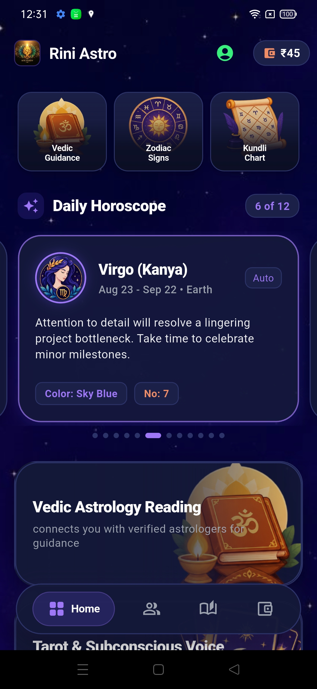
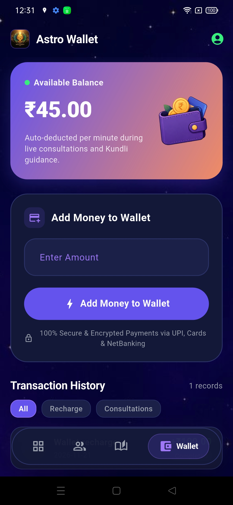
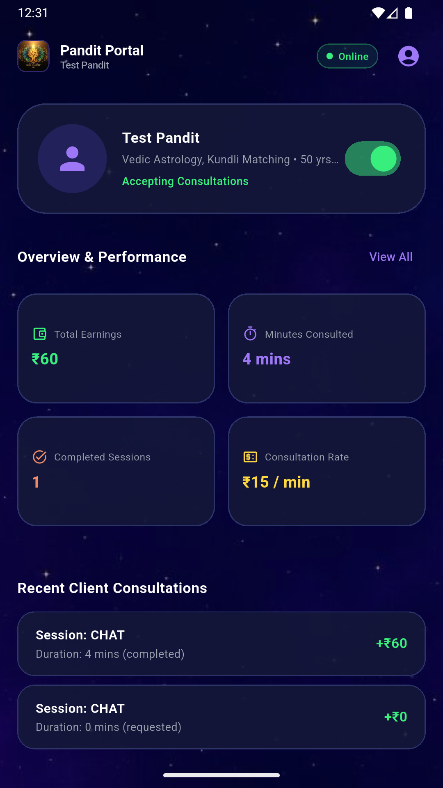

# Rini Pandit - Real-time Vedic Astrology & Consultation Platform

Rini Pandit is an enterprise-grade Vedic astrology and live consultation ecosystem comprising a Flutter mobile application, an Express.js & TypeScript real-time WebSocket backend gateway, and a PostgreSQL database managed via Supabase. The platform provides real-time astrologer availability, live one-on-one chat consultations, automated per-minute billing and ledger transactions, kundli horoscope calculations, and a dedicated portal for astrologers (pandits).

---

## Table of Contents

- [Visual Showcase](#visual-showcase)
- [System Architecture](#system-architecture)
- [Core Features](#core-features)
  - [Client Application](#client-application)
  - [Pandit (Astrologer) Portal](#pandit-astrologer-portal)
  - [Real-time Consultation & Billing Engine](#real-time-consultation--billing-engine)
- [Technology Stack](#technology-stack)
- [Database Architecture](#database-architecture)
- [WebSocket Communication Protocol](#websocket-communication-protocol)
- [REST API Specifications](#rest-api-specifications)
- [Installation and Setup](#installation-and-setup)
  - [Prerequisites](#prerequisites)
  - [Backend Setup](#backend-setup)
  - [Frontend Setup](#frontend-setup)
  - [Database Migration](#database-migration)
- [Environment Configuration](#environment-configuration)
- [Project Directory Structure](#project-directory-structure)

---

## Visual Showcase

| Client Home Page | Astrologer Marketplace |
| :---: | :---: |
|  |  |
| Daily Panchang, Horoscopes & Top Astrologers | Category Filtering, Ratings & Real-time Online Status |

| Client Wallet & Ledger | Pandit Dashboard |
| :---: | :---: |
|  |  |
| Wallet Balance, Top-up & Transaction History | Real-time Status Switch, Live Earnings & Metrics |

---

## System Architecture

```
+-----------------------------------------------------------------------------------+
|                                  FLUTTER CLIENT                                   |
|  (Client Interface / Pandit Dashboard / Live Chat / Wallet / Kundli / Horoscope)  |
+----------------------------------------+------------------------------------------+
                                         |
                       +-----------------+-----------------+
                       |                                   |
                HTTP REST (Dio)                     WebSocket (ws)
                       |                                   |
+----------------------v-----------------------------------v------------------------+
|                                EXPRESS.JS BACKEND                                 |
|                                                                                   |
|  +--------------------+  +----------------------+  +---------------------------+  |
|  | REST Controllers   |  | Billing Engine       |  | Consultation WebSocket    |  |
|  | - Auth / Profiles  |  | - 60s Heartbeat      |  | - Connection routing      |  |
|  | - Astrologers      |  | - Per-minute ledger  |  | - Incoming request alert  |  |
|  | - Pandit Dashboard |  | - Auto-termination   |  | - Real-time status sync   |  |
|  | - Wallet Ledger    |  |   on zero balance    |  | - Chat message delivery   |  |
|  +--------------------+  +----------------------+  +---------------------------+  |
|                                                                                   |
|  +-----------------------------------------------------------------------------+  |
|  | State Store & Synchronization Layer (In-Memory Fallback + Supabase Client)  |  |
|  +-----------------------------------------------------------------------------+  |
+----------------------------------------+------------------------------------------+
                                         |
                               Supabase Client (PostgreSQL)
                                         |
+----------------------------------------v------------------------------------------+
|                               POSTGRESQL DATABASE                                 |
|  - profiles: User & pandit balances, personal profiles                            |
|  - astrologers: Marketplace records, specialties, rates, online/busy status       |
|  - consultations: Live session logs, durations, total billing                     |
|  - wallet_transactions: Double-entry audit ledger (debits and credits)            |
|  - chat_messages: Historical consultation messaging transcript                    |
+-----------------------------------------------------------------------------------+
```

---

## Core Features

### Client Application
- **Astrologer Directory:** Browse astrologers filtered by specialty (Vedic, Kundli, Tarot, Numerology, Vastu) with ratings, years of experience, languages spoken, and per-minute consultation rates.
- **Real-time Online Indicators:** Visual presence badge synchronized via WebSocket showing whether each astrologer is currently online, busy in consultation, or offline.
- **One-on-One Live Chat Consultation:** Real-time messaging with incoming and outgoing timestamps, active billing timers, and connection status.
- **In-App Wallet & Transaction Ledger:** Real-time wallet balance tracking, multiple quick recharge denominations, and an itemized ledger categorizing all debits and credits.
- **Kundli & Birth Chart Calculation:** Complete Vedic Kundli generator computing Lagna (Ascendant), Moon sign, Nakshatra, planetary degrees, and comprehensive house placements.
- **Daily Horoscope & Panchang:** Astrological insights across all 12 zodiac signs alongside daily Tithi, Nakshatra, Yoga, and Karana data.

### Pandit (Astrologer) Portal
- **Online/Offline Availability Switch:** Instant toggle broadcasting status changes to all connected clients in real time via WebSocket.
- **Incoming Consultation Alerts:** Push notification dialogs enabling pandits to accept or decline incoming client consultation requests.
- **Live Earnings & Performance Metrics:** Dedicated analytics displaying cumulative earnings, total minutes consulted, completed session count, and active rate per minute.
- **Profile Customization:** Management of display names, bio descriptions, consultation pricing, specialties, and experience credentials.

### Real-time Consultation & Billing Engine
- **Automated Per-Minute Deduction:** Precise 60-second billing heartbeat that debits the client's wallet balance and credits the pandit's account concurrently.
- **Double-Entry Financial Ledger:** Every transaction writes matched debit and credit rows to PostgreSQL with reference IDs tied to the consultation session.
- **Zero-Balance Protection:** Automatic termination of live sessions if client balance drops below the astrologer's per-minute rate, preventing negative balances.
- **Multi-Client State Broadcast:** Broadcasts live status and balance updates across active sockets without requiring manual page refreshes.

---

## Technology Stack

- **Frontend:**
  - Framework: Flutter 3.x (Dart 3.x)
  - State Management: Provider (`ChangeNotifier`, `Consumer`)
  - HTTP Networking: Dio
  - WebSocket: `web_socket_channel`
  - Local Storage: `shared_preferences`
  - UI Design: Custom dark celestial theme (`AppTheme`), shimmer loading effects, vector icons
- **Backend:**
  - Runtime: Node.js (v20+) with TypeScript
  - Web Server: Express.js
  - WebSocket Gateway: `ws`
  - Validation: Zod
  - Database Client: `@supabase/supabase-js`
- **Database:**
  - PostgreSQL (Supabase managed instance)
  - UUID primary and foreign keys
  - Custom PostgreSQL enumerations (`session_type`, `session_status`, `tx_type`)
  - Row Level Security (RLS) policies

---

## Database Architecture

### Entity Schema Summary

#### 1. `profiles`
Represents client devotees and pandit account identities.
- `id` (UUID, Primary Key): Unique profile identifier.
- `auth_user_id` (UUID, Unique, Optional): References Supabase auth.users.
- `phone` (VARCHAR, Unique): Mobile phone number.
- `full_name` (VARCHAR): Full name of the user or astrologer.
- `gender` (VARCHAR): Gender identity (`male`, `female`, `other`).
- `dob` (DATE): Date of birth.
- `tob` (TIME): Time of birth.
- `pob_city` (VARCHAR): City of birth.
- `pob_country` (VARCHAR): Country of birth.
- `wallet_balance` (DECIMAL): Available account balance (enforces `>= 0.00`).
- `avatar_url` (TEXT): Profile image URL.

#### 2. `astrologers`
Represents astrologer marketplace profiles and live statuses.
- `id` (UUID, Primary Key): Unique astrologer identifier.
- `profile_id` (UUID, Foreign Key): References `profiles(id)`.
- `display_name` (VARCHAR): Professional display name.
- `specialties` (TEXT[]): List of expertise domains.
- `languages` (TEXT[]): List of languages spoken.
- `experience_years` (INT): Years of active practice.
- `rate_per_minute` (DECIMAL): Fee charged per consultation minute.
- `rating` (DECIMAL): Average review score (e.g., 4.9).
- `total_reviews` (INT): Total reviews received.
- `is_online` (BOOLEAN): Real-time availability indicator.
- `is_busy` (BOOLEAN): Current active consultation flag.
- `bio` (TEXT): Professional biographical background.
- `avatar_url` (TEXT): Photo URL.

#### 3. `consultations`
Tracks individual live consultation sessions and billing records.
- `id` (UUID, Primary Key): Consultation identifier.
- `user_id` (UUID, Foreign Key): References `profiles(id)`.
- `astrologer_id` (UUID, Foreign Key): References `astrologers(id)`.
- `type` (`session_type` ENUM): `'chat'`, `'voice'`, `'video'`.
- `status` (`session_status` ENUM): `'requested'`, `'accepted'`, `'active'`, `'completed'`, `'cancelled'`, `'insufficient_balance'`.
- `rate_per_minute` (DECIMAL): Fixed session rate.
- `duration_seconds` (INT): Cumulative live duration.
- `total_deducted` (DECIMAL): Total currency transferred.
- `started_at` (TIMESTAMP WITH TIME ZONE): Start timestamp.
- `ended_at` (TIMESTAMP WITH TIME ZONE): End timestamp.

#### 4. `wallet_transactions`
Audited financial transaction ledger.
- `id` (UUID, Primary Key): Unique transaction identifier.
- `user_id` (UUID, Foreign Key): References `profiles(id)`.
- `amount` (DECIMAL): Transaction value (negative for debits, positive for credits).
- `type` (`tx_type` ENUM): `'recharge'`, `'consultation_debit'`, `'refund'`, `'promo_credit'`.
- `reference_id` (UUID, Optional): References associated `consultations(id)`.
- `description` (VARCHAR): Human-readable ledger remark.
- `balance_after` (DECIMAL): Balance immediately following transaction.
- `created_at` (TIMESTAMP WITH TIME ZONE): Record creation time.

#### 5. `chat_messages`
Stores transcripts of active and past consultations.
- `id` (UUID, Primary Key): Message identifier.
- `consultation_id` (UUID, Foreign Key): References `consultations(id)`.
- `sender_id` (UUID, Foreign Key): References `profiles(id)`.
- `content` (TEXT): Text payload.
- `is_read` (BOOLEAN): Read receipt status.
- `created_at` (TIMESTAMP WITH TIME ZONE): Delivery time.

---

## WebSocket Communication Protocol

All real-time coordination connects via `ws://<host>:<port>/ws/consultation?userId=<UUID>`.

### Client to Server Events
- `consultation:initiate`: Sent by client to request a consultation with an astrologer.
  ```json
  { "event": "consultation:initiate", "data": { "astrologerId": "<UUID>" } }
  ```
- `consultation:accept`: Sent by pandit to accept a pending invitation.
  ```json
  { "event": "consultation:accept", "data": { "sessionId": "<UUID>" } }
  ```
- `consultation:decline`: Sent by pandit to decline an invitation.
  ```json
  { "event": "consultation:decline", "data": { "sessionId": "<UUID>" } }
  ```
- `chat:send`: Sends a message within an active consultation.
  ```json
  { "event": "chat:send", "data": { "sessionId": "<UUID>", "content": "Pranam Pandit Ji" } }
  ```
- `consultation:end`: Ends the active consultation session.
  ```json
  { "event": "consultation:end", "data": { "sessionId": "<UUID>" } }
  ```
- `astrologer:status`: Toggles online/busy state for an astrologer.
  ```json
  { "event": "astrologer:status", "data": { "astrologerId": "<UUID>", "isOnline": true, "isBusy": false } }
  ```

### Server to Client Events
- `consultation:waiting`: Confirms request receipt; client awaits pandit acceptance.
- `consultation:incoming_request`: Dispatches invitation to the target pandit.
- `consultation:started`: Confirms acceptance and establishes live session.
- `consultation:timer_started`: Signals commencement of live countdown and billing.
- `chat:message`: Broadcasts incoming chat message to participants.
- `billing:tick`: Dispatches per-minute deduction and updated wallet balance.
- `consultation:ended`: Notifies participants of session conclusion with metrics.
- `astrologer:status`: Broadcasts real-time astrologer availability to all clients.

---

## REST API Specifications

The Express.js REST API is served on both `/api` and `/` endpoints.

### Authentication & Profiles
- `POST /api/auth/signup`: Registers a new user or pandit account.
- `POST /api/auth/login`: Authenticates user credentials and returns session tokens.
- `GET /api/user/me`: Retrieves the authenticated user profile and role details.
- `PUT /api/user/profile`: Updates profile details (birth data, name, gender).

### Astrologer Marketplace
- `GET /api/astrologers`: Lists marketplace astrologers with optional `?specialty=` filter.
- `GET /api/astrologers/:id`: Retrieves full public details of a specific astrologer.

### Pandit Operations
- `GET /api/pandit/profile`: Fetches pandit profile details and cumulative earnings.
- `PUT /api/pandit/status`: Updates availability (`isOnline`, `isBusy`, `ratePerMinute`, `bio`).
- `GET /api/pandit/earnings/:id`: Returns total earnings, minutes consulted, and past sessions.
- `GET /api/pandit/sessions/:id`: Retrieves consultation session history for an astrologer.

### Wallet & Ledger
- `GET /api/wallet/balance`: Returns the current wallet balance.
- `POST /api/wallet/recharge`: Credits funds to wallet balance and logs a transaction.
- `GET /api/wallet/transactions`: Returns paginated ledger transactions for the authenticated user.

### Astrology Tools
- `GET /api/astrology/horoscope`: Returns daily horoscopes across zodiac signs.
- `GET /api/astrology/panchang`: Returns daily Vedic calendar (Tithi, Nakshatra, Yoga).
- `POST /api/astrology/kundli`: Generates birth chart calculations and planetary placements.

---

## Installation and Setup

### Prerequisites
- Flutter SDK (version 3.22 or higher)
- Node.js (version 20 or higher) & npm
- Supabase project instance (hosted or local via Supabase CLI)

### Backend Setup

1. Navigate to the backend directory:
   ```bash
   cd backend
   ```

2. Install dependencies:
   ```bash
   npm install
   ```

3. Configure environment variables in `.env`:
   ```bash
   PORT=5001
   SUPABASE_URL=https://your-project.supabase.co
   SUPABASE_ANON_KEY=your-supabase-anon-key
   SUPABASE_SERVICE_ROLE_KEY=your-supabase-service-role-key
   ```

4. Build TypeScript source:
   ```bash
   npm run build
   ```

5. Start the server:
   ```bash
   # Development mode with hot-reload
   npm run dev

   # Production mode
   npm start
   ```

### Frontend Setup

1. Navigate to the frontend directory:
   ```bash
   cd frontend
   ```

2. Install Flutter packages:
   ```bash
   flutter pub get
   ```

3. Configure API endpoints in `lib/core/constants/api_constants.dart`:
   ```dart
   class ApiConstants {
     static const String baseUrl = 'http://localhost:5001/api';
     static const String wsUrl = 'ws://localhost:5001/ws/consultation';
     static const String supabaseUrl = 'https://your-project.supabase.co';
     static const String supabaseAnonKey = 'your-anon-key';
     static const String defaultUserId = 'a0000000-0000-0000-0000-000000000001';
   }
   ```

4. Run the Flutter application:
   ```bash
   # Run on connected device or emulator
   flutter run

   # Run on Chrome for web testing
   flutter run -d chrome
   ```

### Database Migration

Apply the database schema to your Supabase project:
1. Open the Supabase Dashboard SQL Editor.
2. Execute the contents of `supabase/schema.sql` to initialize extensions, enums, tables, and indexes.
3. (Optional) Execute `supabase/seed.sql` to populate initial astrologers and test data.

---

## Environment Configuration

| Variable | Location | Description |
| :--- | :--- | :--- |
| `PORT` | `backend/.env` | Network port for the Express HTTP and WebSocket server (Default: `5001`) |
| `SUPABASE_URL` | `backend/.env` | URL of the Supabase project instance |
| `SUPABASE_ANON_KEY` | `backend/.env` | Public anonymous key for client operations |
| `SUPABASE_SERVICE_ROLE_KEY` | `backend/.env` | Service role key for elevated ledger updates and migrations |

---

## Project Directory Structure

```
RiniPandit/
├── ScreenShots/                               # Application UI documentation screenshots
│   ├── client_homepage.jpg                    # Client landing page & daily horoscopes
│   ├── client_astrologer_screen.jpg           # Astrologer marketplace & filter view
│   ├── client_wallet.jpg                      # Client wallet & transaction ledger
│   └── Pandit_dashboard.png                   # Pandit portal & real-time analytics
├── supabase/                                  # Database migrations and seed scripts
│   ├── schema.sql                             # Complete PostgreSQL schema definitions
│   └── seed.sql                               # Seed data for astrologers and profiles
├── backend/                                   # Express.js & WebSocket gateway
│   ├── src/
│   │   ├── config/
│   │   │   ├── env.ts                         # Environment variable definitions
│   │   │   └── supabase.ts                    # Supabase database client initialization
│   │   ├── controllers/
│   │   │   ├── astrology.controller.ts        # Horoscope, Panchang & Kundli calculations
│   │   │   ├── astrologers.controller.ts      # Astrologer directory endpoints
│   │   │   ├── auth.controller.ts             # User and Pandit authentication
│   │   │   ├── consultations.controller.ts    # Consultation history & session queries
│   │   │   ├── pandit.controller.ts           # Pandit profile, rates & earnings
│   │   │   ├── user.controller.ts             # Profile management
│   │   │   └── wallet.controller.ts           # Wallet balance, top-up & transactions
│   │   ├── middleware/
│   │   │   └── auth.middleware.ts             # Bearer token validation middleware
│   │   ├── routes/
│   │   │   └── index.ts                       # REST API route mappings
│   │   ├── services/
│   │   │   ├── astrology.ts                   # Planetary calculation logic
│   │   │   ├── billing.ts                     # Real-time per-minute billing engine
│   │   │   └── store.ts                       # Database & in-memory ledger synchronization
│   │   ├── sockets/
│   │   │   └── consultation.socket.ts         # Consultation WebSocket lifecycle
│   │   └── server.ts                          # Express app entry & HTTP/WS server listener
│   ├── package.json
│   └── tsconfig.json
└── frontend/                                  # Flutter mobile application
    ├── assets/                                # Application icons and graphics
    │   ├── logo.png
    │   └── logo.webp
    ├── lib/
    │   ├── core/
    │   │   ├── constants/
    │   │   │   └── api_constants.dart         # API and WebSocket connection URLs
    │   │   └── theme/
    │   │       └── app_theme.dart             # Cosmic purple design system theme
    │   ├── models/
    │   │   ├── astrologer.dart                # Astrologer data model
    │   │   ├── chat_message.dart              # Consultation chat message model
    │   │   ├── consultation_session.dart      # Session model
    │   │   ├── horoscope.dart                 # Daily horoscope model
    │   │   ├── kundli_result.dart             # Birth chart data model
    │   │   ├── user_profile.dart              # User profile model
    │   │   └── wallet_transaction.dart        # Financial ledger record model
    │   ├── providers/
    │   │   └── app_state.dart                 # Central application state manager
    │   ├── screens/
    │   │   ├── astrologer_list_screen.dart    # Full directory screen with filters
    │   │   ├── auth_screen.dart               # Login and registration flow
    │   │   ├── chat_consultation_screen.dart  # Client live chat and consultation room
    │   │   ├── home_screen.dart               # Primary client home screen
    │   │   ├── kundli_screen.dart             # Vedic Kundli calculation screen
    │   │   ├── wallet_screen.dart             # Client wallet and transaction history
    │   │   └── pandit/
    │   │       ├── pandit_chat_screen.dart    # Pandit live chat room
    │   │       ├── pandit_dashboard_screen.dart # Pandit control dashboard
    │   │       ├── pandit_earnings_screen.dart  # Detailed earnings and settlement screen
    │   │       └── pandit_profile_setup_screen.dart # Astrologer onboarding & configuration
    │   ├── services/
    │   │   ├── api_service.dart               # REST API client service
    │   │   └── socket_service.dart            # WebSocket streaming client service
    │   ├── widgets/                           # Reusable UI components
    │   └── main.dart                          # Application entry point
    └── pubspec.yaml
```
