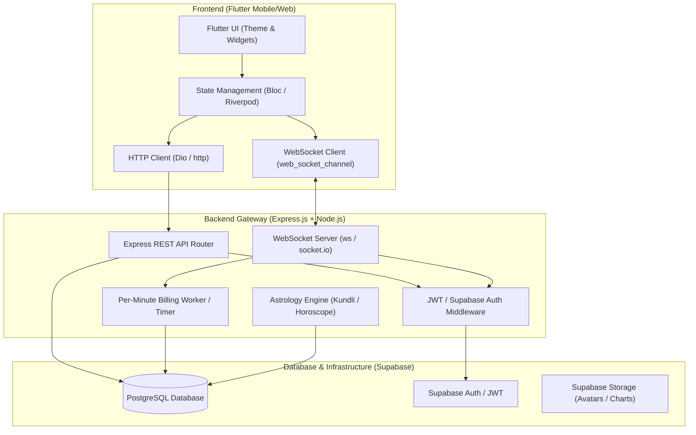
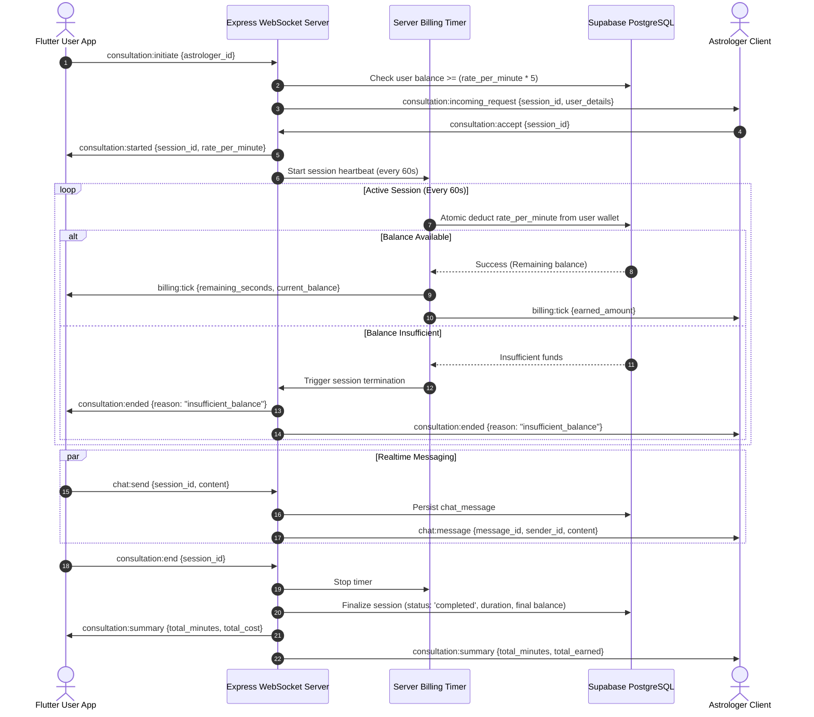

# System Architecture & Technical Specification

## 1. High-Level System Architecture



---

## 2. Tech Stack Definition

- **Frontend**: Flutter (Dart)
  - Navigation & AppTheme: Standardized Material 3 Design System.
  - State Management: `flutter_bloc` or `provider`.
  - Real-time: `web_socket_channel` / `socket_io_client`.
  - Networking & Auth: `supabase_flutter`, `dio`.
- **Backend**: Express.js (Node.js, TypeScript/ESM)
  - REST Framework: `express`
  - WebSockets: `ws` (or `socket.io`) for consultation sessions, live messaging, and billing ticks.
  - Validation: `zod`
  - Supabase Client: `@supabase/supabase-js` (service role client).
- **Server & Persistence**: Supabase
  - Database: PostgreSQL with Row-Level Security (RLS).
  - Authentication: Supabase Auth (Phone/OTP + Email/JWT).
  - Storage: S3-compatible buckets for profile avatars and Janampatri PDFs.

---

## 3. Database Schema (PostgreSQL / Supabase DDL)

```sql
-- Enable UUID extension
CREATE EXTENSION IF NOT EXISTS "uuid-ossp";

-- 1. User Profiles (Extends Supabase auth.users)
CREATE TABLE public.profiles (
    id UUID PRIMARY KEY REFERENCES auth.users(id) ON DELETE CASCADE,
    phone VARCHAR(20) UNIQUE NOT NULL,
    full_name VARCHAR(100),
    gender VARCHAR(10),
    dob DATE,
    tob TIME,
    pob_city VARCHAR(100),
    pob_country VARCHAR(100),
    wallet_balance DECIMAL(10, 2) DEFAULT 0.00 CHECK (wallet_balance >= 0.00),
    avatar_url TEXT,
    created_at TIMESTAMP WITH TIME ZONE DEFAULT NOW(),
    updated_at TIMESTAMP WITH TIME ZONE DEFAULT NOW()
);

-- 2. Astrologers Table
CREATE TABLE public.astrologers (
    id UUID PRIMARY KEY DEFAULT uuid_generate_v4(),
    user_id UUID REFERENCES public.profiles(id) ON DELETE CASCADE,
    display_name VARCHAR(100) NOT NULL,
    specialties TEXT[] NOT NULL DEFAULT '{}', -- e.g. {'Vedic', 'Tarot', 'Numerology'}
    languages TEXT[] NOT NULL DEFAULT '{"English", "Hindi"}',
    experience_years INT DEFAULT 1,
    rate_per_minute DECIMAL(10, 2) NOT NULL,
    rating DECIMAL(2, 1) DEFAULT 5.0,
    total_reviews INT DEFAULT 0,
    is_online BOOLEAN DEFAULT false,
    is_busy BOOLEAN DEFAULT false,
    bio TEXT,
    avatar_url TEXT,
    created_at TIMESTAMP WITH TIME ZONE DEFAULT NOW()
);

-- 3. Consultation Sessions
CREATE TYPE session_type AS ENUM ('chat', 'voice', 'video');
CREATE TYPE session_status AS ENUM ('requested', 'accepted', 'active', 'completed', 'cancelled', 'insufficient_balance');

CREATE TABLE public.consultations (
    id UUID PRIMARY KEY DEFAULT uuid_generate_v4(),
    user_id UUID NOT NULL REFERENCES public.profiles(id),
    astrologer_id UUID NOT NULL REFERENCES public.astrologers(id),
    type session_type NOT NULL DEFAULT 'chat',
    status session_status NOT NULL DEFAULT 'requested',
    rate_per_minute DECIMAL(10, 2) NOT NULL,
    duration_seconds INT DEFAULT 0,
    total_deducted DECIMAL(10, 2) DEFAULT 0.00,
    started_at TIMESTAMP WITH TIME ZONE,
    ended_at TIMESTAMP WITH TIME ZONE,
    created_at TIMESTAMP WITH TIME ZONE DEFAULT NOW()
);

-- 4. Realtime Chat Messages
CREATE TABLE public.chat_messages (
    id UUID PRIMARY KEY DEFAULT uuid_generate_v4(),
    consultation_id UUID NOT NULL REFERENCES public.consultations(id) ON DELETE CASCADE,
    sender_id UUID NOT NULL REFERENCES public.profiles(id),
    content TEXT NOT NULL,
    is_read BOOLEAN DEFAULT false,
    created_at TIMESTAMP WITH TIME ZONE DEFAULT NOW()
);

-- 5. Wallet Ledger / Transactions
CREATE TYPE tx_type AS ENUM ('recharge', 'consultation_debit', 'refund', 'promo_credit');

CREATE TABLE public.wallet_transactions (
    id UUID PRIMARY KEY DEFAULT uuid_generate_v4(),
    user_id UUID NOT NULL REFERENCES public.profiles(id) ON DELETE CASCADE,
    amount DECIMAL(10, 2) NOT NULL,
    type tx_type NOT NULL,
    reference_id UUID, -- References consultation id if debit
    description VARCHAR(255),
    balance_after DECIMAL(10, 2) NOT NULL,
    created_at TIMESTAMP WITH TIME ZONE DEFAULT NOW()
);
```

---

## 4. Real-Time WebSocket Protocol & State Machine

### WebSocket Connection URL
`ws://<host>:<port>/ws/consultation?token=<JWT_TOKEN>`

### Sequence & Lifecycle Flow



### WebSocket Event Payloads

1. **`connection` (Handshake)**:
   - Header: `Authorization: Bearer <jwt>`
   - Server registers client socket map: `Map<userId, WebSocket>`
2. **`chat:send` / `chat:message`**:
   ```json
   {
     "event": "chat:send",
     "data": {
       "sessionId": "UUID",
       "content": "Hello Pandit ji, please check my chart."
     }
   }
   ```
3. **`billing:tick`**:
   ```json
   {
     "event": "billing:tick",
     "data": {
       "sessionId": "UUID",
       "elapsedMinutes": 3,
       "deducted": 30.00,
       "walletBalance": 120.00
     }
   }
   ```
4. **`consultation:end`**:
   ```json
   {
     "event": "consultation:end",
     "data": {
       "sessionId": "UUID",
       "reason": "user_terminated"
     }
   }
   ```

---

## 5. REST API Specifications (Express.js)

### Authentication & Profile
- `POST /api/auth/verify-token` — Validate Supabase JWT and sync local session.
- `GET /api/user/profile` — Fetch profile including birth details and wallet balance.
- `PUT /api/user/profile` — Update birth details (Name, DOB, TOB, POB).

### Astrologers
- `GET /api/astrologers` — List astrologers with filters (`specialty`, `language`, `is_online`, `sort`).
- `GET /api/astrologers/:id` — Get detailed profile, reviews, and pricing.

### Wallet
- `GET /api/wallet/balance` — Current wallet balance and summary.
- `POST /api/wallet/recharge` — Mock/payment intent creation to add funds to balance.
- `GET /api/wallet/transactions` — Ledger history.

### Consultations & History
- `GET /api/consultations/history` — Past consultation sessions and chat logs.
- `GET /api/consultations/:id/messages` — Fetch message log for a completed session.

### Astrology Services
- `GET /api/astrology/horoscope?sign=aries` — Returns daily/weekly horoscope predictions.
- `POST /api/astrology/kundli` — Accepts `{dob, tob, pob_lat, pob_lng}` and returns basic planetary positions and ascendant.

---

## 6. Directory Structure

```
RiniPandit/
├── backend/                  # Express.js Application
│   ├── src/
│   │   ├── config/           # Supabase client & environment variables
│   │   ├── controllers/      # REST API handlers
│   │   ├── middleware/       # Auth JWT verification & error handling
│   │   ├── routes/           # Express routes
│   │   ├── services/         # Business logic (Astro engine, wallet, consultations)
│   │   ├── sockets/          # WebSocket connection manager & event handlers
│   │   └── server.ts         # Express & HTTP/WS server entrypoint
│   ├── package.json
│   └── tsconfig.json
│
├── frontend/                 # Flutter Application
│   ├── lib/
│   │   ├── core/
│   │   │   ├── constants/    # Endpoints, WS URLs, asset strings
│   │   │   ├── network/      # Dio HTTP & WebSocket clients
│   │   │   └── theme/        # AppTheme (colors, typography, component styles)
│   │   ├── models/           # Dart data models (Profile, Astrologer, Message, etc.)
│   │   ├── providers/        # State management (Blocs / Controllers)
│   │   ├── screens/          # UI Views (Home, AstrologerList, ChatSession, Wallet)
│   │   ├── widgets/          # Reusable shared UI widgets
│   │   └── main.dart
│   └── pubspec.yaml
│
├── progress.md               # Project progress & checklist tracker
└── architecture.md           # System design & protocol specification
```
